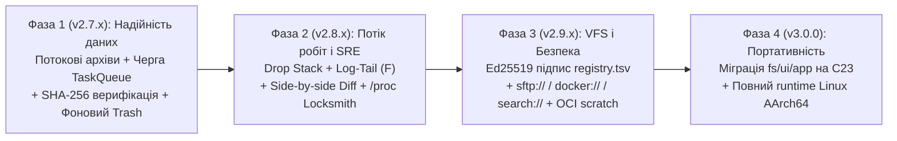

# Детальний план розвитку Duop (`v2.7.0` → `v3.0.0`)

> **Дата документа:** 2026-11-17  
> **Базова версія:** `v2.6.11` (`70` модулів `.c`, `145` модулів `.s`, `107` тестових наборів `tests/test_*.py`, статичний ELF `~192–193 КіБ`)  
> **Підстава:** інженерний аналіз звіту про слабкі сторони та затребувані функції сучасних файлових менеджерів (листопад 2026)

---

## Мета та стратегічне позиціонування

На основі інженерного аналізу звіту цей план визначає покрокову дорожню карту розвитку **Duop** із збереженням філософії проєкту.

Головний висновок ринку 2025–2026 років: користувачі відмовляються від важких оболонок (`WinUI 3`, `Electron`, `Tauri`) і фонових демонів-індексаторів (`Baloo`, `Tracker`) на користь швидких нативних інструментів (`File Pilot`, `Yazi`, `Everything`), але очікують від них **надійності передачі даних рівня `TeraCopy`**, **гнучкого збору файлів (`Drop Stack`)**, **Dev/SRE-інструментів** та **підключення віддалених сховищ без ризику для UI**.

План зберігає незмінні інваріанти [AGENTS.md](../AGENTS.md):
- **Zero `libc`, нуль зовнішніх runtime-залежностей**, статичний ELF (`audit_elf_hardening.py`).
- **Суворе низхідне шарування** (`include/` → `src/os/` → `src/core/` → `src/tui/` / `src/fs/` → `src/ui/` → `src/app/`).
- **Новий код — на портативному freestanding C23** (`C_SRCS`, `include/duop_*.h`, фрейм ≤ 4608 B, `[[nodiscard]]`); асемблер — лише для PAL/SIMD у `src/os/`.
- **Бюджети `duop-lean-modules`**: файл ≤ 500 рядків, функція ≤ 80 рядків, ≤ 16 не-`static` символів.
- **TDD-first (`duop-tdd-first`)**: спочатку регресійні/інтеграційні тести в `tests/`, потім реалізація, і перевірка через `.agents/skills/duop-pty-verify/scripts/verify_build.sh`.



---

## Архітектурні рішення та анти-вектор

1. **Мова реалізації нових модулів:** у старому документі [ARCHIVE_TOOLS_PLAN.md](ARCHIVE_TOOLS_PLAN.md) модулі `inflate_stream.s`, `archive_unpack.s`, `deflate.s`, `archive_pack.s` проєктувалися на x86-64 asm. За актуальними правилами `AGENTS.md` («New code is C by default»), **всі нові модулі пишуться на freestanding C23** (`.c`), що автоматично робить їх готовими для AArch64.
2. **Журнал операцій (`ops.log`):** легкий append-only TSV-журнал у `$XDG_STATE_HOME/duop/ops.log` (з ротацією при перевищенні 1 МіБ), без SQLite або бінарних БД.
3. **Відмова від вбудованого AI/RAG та TLS/SSH у бінарнику:** семантичний/повнотекстовий пошук (`search://`) та віддалені протоколи (`sftp://`, `s3://`, `docker://`) реалізуються **виключно** як out-of-process `pkg_vfs`-провайдери (`virtual_mode = 3`), щоб не тягнути OpenSSL/libssh2/векторні рушії в статичний ELF.

---

## Відкриті питання (перед стартом реалізації)

1. **Пріоритет старту:** рухатися послідовно з **Фази 1 (Архіви + Черга передач + SHA-256)** чи паралельно брати **Drop Stack / Log-Tail** із Фази 2?
2. **Гаряча клавіша для Drop Stack:** чи підходить `Alt+Space` (або `Ctrl+B`) для додавання/зняття файлу в крос-директорний стек?
3. **Ключ підпису `registry.tsv`:** для `Ed25519`/`minisign` верифікації — чи генерується пара ключів проєкту з публічним ключем у `.rodata` та опційним флагом `--allow-unsigned-registry` для локальних/тестових реєстрів?

---

## Фаза 1 (`v2.7.x`) — Надійність даних і «TeraCopy-рівень» у ядрі

### 1.1 Повноцінна робота з архівами (реалізація `ARCHIVE_TOOLS_PLAN.md` у C23)
> **Оновлено:** актуальний, детальніший і затверджений план — [ARCHIVE_TOOLS_PLAN.md](ARCHIVE_TOOLS_PLAN.md) (фази 0–5, `Alt+F5`/`Alt+F9` замість `Alt+P`, кодеки bz2/xz/zstd). Нижче — первісний начерк.

Замість обмеженого read-only буфера (`4 МіБ` / `1024` записи) переходимо на `os_mmap_file_ro` (із захистом `SIGBUS` у PAL) та потоковий RFC 1951.

- **`[NEW] src/fs/inflate_stream.c`**
  - Потоковий `DEFLATE` із кільцевим словником `32 КіБ` та вихідним буфером `64 КіБ` (алокація через `mem_alloc`, фрейм функції ≤ 4608 B).
  - На кожному `64 КіБ` чанку:
    - інкрементальний підрахунок `crc32_update` ([src/core/hash.c](../src/core/hash.c));
    - опитування `fs_progress_cancelled()` для миттєвого переривання Zip-Bomb по `Esc`.
  - Підтримка режиму «null-sink» (для `Test Archive` без запису на диск).
- **`[NEW] src/fs/archive_unpack.c`**
  - `arc_sanitize_relpath(const char *raw, char *out, size_t cap)`: відкидає початковий `/`, сегменти `.` / `..`, NUL-байти, перевіряє `PATH_MAX` (Anti-Zip-Slip).
  - Рекурсивне розпакування позначених файлів/тек із `virtual_mode == 2` у цільову панель через `TaskWorker` (`F5`).
  - Створення тек і файлів виключно через `os_openat(..., O_NOFOLLOW | ...)`; звірка `CRC32` після запису (при невідповідності — видалення пошкодженого файлу та повернення `-EIO`).
  - Відновлення `mode` і `mtime` через `os_fchmodat` / PAL.
- **`[NEW] src/fs/deflate.c` & `src/fs/archive_pack.c`**
  - Компактний компресор RFC 1951 (`Stored` рівень 0 + `LZ77` на 3-байтових хеш-ланцюжках із Fixed Huffman `BTYPE=01`).
  - Запис `.tar` (USTAR 512-байтові блоки), `.tar.gz` (RFC 1952 header + `deflate` + `CRC32`/`ISIZE`), `.zip`/ZIP64 (при > 4 ГіБ або > 65535 файлів).
  - Інтеграція з `Alt+P` / `PopupMenu` (діалог вибору формату й імені) та `Test Archive`.
- **`[MODIFY]` [src/fs/archive_vfs.s](../src/fs/archive_vfs.s), [src/fs/archive_extract.s](../src/fs/archive_extract.s), [src/app/app_arc.s](../src/app/app_arc.s)**
  - Заміна ліміту `1024` записів на динамічний `mem_realloc` (`256 → 512 → ...`) та `os_mmap_file_ro` для `.tar`/`.zip` (і потокове розпакування `.tar.gz` у `tmp_open_unique` + `mmap`).
  - Оновлення `include/duop_fs.h`, `include/types.inc`, `src/tui/i18n_en.lang`, `lang/uk.lang`.

### 1.2 Послідовна черга передач (`TaskQueue`), SHA-256 верифікація, журнал і фоновий Trash
Наразі [src/app/app_task.s](../src/app/app_task.s) повертає `-EBUSY`, якщо фонова задача вже активна, а cross-FS `Trash` у [src/fs/trash_undo.c](../src/fs/trash_undo.c) виконується в UI-потоці.

- **`[NEW] src/fs/task_queue.c`**
  - Кільцева черга `TaskJob` (ємність за замовчуванням 32 задачі, динамічне розширення через `mem_realloc`).
  - `task_queue_push(TaskJob *job)`: якщо воркер вільний — запускає одразу; якщо зайнятий — додає в чергу, інформує `StatusBar` (`[Queue: N]`).
  - `task_queue_next()`: викликається в `App_task_tick` після завершення поточного `fork`-воркера; автоматично стартує наступну задачу без конкуренції за диск/мережу.
  - Прапорець `TASK_FLAG_VERIFY_SHA256` у `TaskJob`: після копіювання регулярного файлу воркер обчислює SHA-256 джерела і приймача (через [src/core/hash_file.c](../src/core/hash_file.c)) і при розбіжності позначає файл як failed без видалення джерела при `Move`.
- **`[NEW] src/fs/ops_log.c`**
  - Потокобезпечний (один запис на операцію через `O_APPEND` у воркері) журнал `$XDG_STATE_HOME/duop/ops.log` (fallback `~/.local/state/duop/ops.log`).
  - Формат рядка: `<unix_ts>\t<OP:COPY|MOVE|TRASH|UNPACK|PACK>\t<OK|ERR|SKIP>\t<bytes>\t<sha256_or_->\t<src>\t<dst>\n`.
  - Автоматична ротація в `ops.log.1` при перевищенні `1 МіБ` (`duop-bounded-resources`).
  - Команда в `Command Palette` (`Ctrl+K`) для відкриття `ops.log` у `ViewerDialog`.
- **`[MODIFY]` [src/app/app_task.s](../src/app/app_task.s) & [src/fs/trash_undo.c](../src/fs/trash_undo.c)**
  - У `App_task_start`: замість `-EBUSY` — ставити `TaskJob` у `task_queue_push` (із показом у `ProgressDialog` індикатора черги).
  - Додати `TASK_OP_TRASH`: переміщення в кошик (включно з cross-FS `EXDEV` копіюванням) виконується у фоновому `fork`-воркері, не блокуючи UI.

---

## Фаза 2 (`v2.8.x`) — Ергономіка потоку робіт та SRE/Dev-інструменти

### 2.1 Drop Stack (Крос-директорний буфер збору файлів)
- **`[NEW] src/fs/drop_stack.c`**
  - Зберігає список унікальних абсолютних шляхів (`char **paths`, `uint32_t count, cap`), зібраних з будь-яких тек/вкладок.
  - Операції: `drop_stack_toggle(path)`, `drop_stack_clear()`, `drop_stack_remove_missing()`, `drop_stack_load_into_model(DirModel *m)` (віртуальний режим `virtual_mode = 4`, бейдж `[Stack: N]`).
  - Інтеграція з `FilePane`: маркер у рядку біля імені, підтримка `F5`/`F6`/`Del`/`Alt+B` (Bulk Rename) та `%F` у User Menu для всього стеку.
- **`[MODIFY]` [src/app/app_ext_keys.s](../src/app/app_ext_keys.s) & [src/ui/file_pane_render.s](../src/ui/file_pane_render.s)**
  - Гаряча клавіша (`Alt+Space` або обрана користувачем) додає/прибирає поточний чи позначені файли в Drop Stack; пункт у `Command Palette` і `PopupMenu` відкриває Drop Stack у активній панелі.

### 2.2 Live Log-Tailing (`F`) та Side-by-side Text Diff у `ViewerDialog`
- **`[NEW] src/ui/viewer_follow.c` & `src/ui/viewer_diff.c`**
  - **Follow-режим (`F` у [src/ui/viewer_dialog.s](../src/ui/viewer_dialog.s)):**
    - Підключає `os_watch_add` (`inotify` `IN_MODIFY | IN_TRUNCATE`) на відкритий файл у спільний `ppoll`-цикл ([src/app/app_events.s](../src/app/app_events.s)).
    - При зростанні розміру файлу перемаплює через `os_mmap_file_ro` і автопрокручує вниз (`[FOLLOW]`); при скороченні (`truncate`) — скидає офсет без `SIGBUS`.
  - **Side-by-side Text Diff:**
    - Команда з `Command Palette` / `Alt+Shift+=` (коли в лівій і правій панелях виділено два регулярні файли ≤ `4 МіБ` для diff із лінійним fallback).
    - Рендерить дві синхронно прокручувані колонки у `ViewerDialog` з TrueColor-підсвіткою доданих/видалених/змінених рядків.

### 2.3 Виявлення блокувань файлів (`/proc/*/fd` Locksmith)
- **`[NEW] src/fs/proc_locks.c`**
  - Без жодних фонових демонів: викликається **лише за запитом** (дія `Who locks this file?` у `Alt+I` / `PopupMenu` або при `-EBUSY` / `-ETXTBSY`).
  - Одноразово сканує `/proc/<pid>/fd/*` через `os_dir_read` + `os_readlinkat`, звіряючи `dev:ino` з цільовим файлом, і читає `/proc/<pid>/comm` + `uid`.
  - Показує список процесів (`PID`, `comm`, режим `r/w`) у діалозі з можливістю надіслати `SIGTERM` або скопіювати PID.

---

## Фаза 3 (`v2.9.x`) — Безпечна VFS-екосистема та OCI Rescue-образ

### 3.1 Криптографічний підпис реєстру пакетів (`Ed25519` / `minisign`)
- **`[NEW] src/core/ed25519.c`**
  - Компактна freestanding реалізація перевірки підпису **Ed25519** (~350–450 рядків C23 без `libc`, без heap-алокацій).
  - Вбудований у `.rodata` публічний ключ проєкту; при `duop pkg update` перевіряється `registry.tsv.sig` перед парсингом `registry.tsv`.
- **`[MODIFY]` [src/fs/pkg_verify.c](../src/fs/pkg_verify.c) & [src/fs/pkg_registry.c](../src/fs/pkg_registry.c)**
  - Обов'язкова перевірка підпису реєстру з локалізованим повідомленням у `StatusBar`/CLI при невідповідності.

### 3.2 Офіційні VFS-провайдери (`virtual_mode = 3`) та `FROM scratch` образ
Всі провайдери працюють поверх контракту `LIST`/`READ` у [src/fs/pkg_vfs_pane.s](../src/fs/pkg_vfs_pane.s) як окремі пакети в `packages/`:
1. **`packages/duop-vfs-sftp/`:** навігація й копіювання `sftp://user@host/path` через системний `sftp`/`ssh` у batch-режимі (нульовий вплив на розмір `duop`).
2. **`packages/duop-vfs-docker/`:** перегляд контейнерів і файлів усередині них (`docker://container/path`) через `docker`/`podman`.
3. **`packages/duop-vfs-search/`:** міст `search://query` до `rg`/`fd` або локального індексатора користувача з виводом результатів прямо у `FilePane`.
4. **`packaging/oci/Dockerfile`:** багатоетапна збірка `FROM scratch` із єдиним бінарником `/duop`, `/lang/uk.lang`, `/layouts/uk.layout` для миттєвого запуску в `kubectl debug` / `docker cp`.

---

## Фаза 4 (`v3.0.0`) — Завершення міграції на C23 та запуск на Linux AArch64

Дотримуючись плану [HYBRID_PORTABILITY_PLAN.md](HYBRID_PORTABILITY_PLAN.md):
1. **Міграція решти модулів `src/fs/` → `src/ui/` → `src/app/` на freestanding C23:**
   - Кожен модуль фіксується замороженим оракулом у `tests/harness/*_reference.s`, переписується на C23, доводиться еквівалентність диференційним тестом + мутаційною перевіркою (`duop-asm-to-c-migration`) із одночасним спалюванням техборгу в [lean_baseline.json](../.agents/skills/duop-lean-modules/scripts/lean_baseline.json) (зокрема `file_pane_render.s` — 1223 рядки).
2. **Повний runtime-бінарник для `OS=linux ARCH=aarch64`:**
   - Довести `src/os/linux/aarch64/` (`pal_os.s`, `pal_simd.s`, `pal_uring.s`, `pal_pty.s`, `pal_fault.s`) до повного лінкування з C23-шарами (`make OS=linux ARCH=aarch64 release`).
   - Додати прогін AArch64 тестів під `qemu-aarch64-static` у `Makefile` і GitHub Actions CI.

---

## План верифікації (`duop-tdd-first` & `duop-pty-verify`)

### Автоматизовані тести
1. **Нові тестові набори (TDD — пишуться до змін у `src/`):**
   - `tests/test_archive_tools.py` — архіви > 6 МіБ / > 1500 файлів під `MEMCHECK=1`, Zip-Slip (`../`), symlink-атака, пошкоджений CRC32, round-trip пакування.
   - `tests/test_task_queue_verify.py` — послідовна черга 3+ операцій, перевірка SHA-256 після копіювання, симуляція пошкодження приймача, запис в `ops.log` + ротація, фоновий cross-FS `Trash`.
   - `tests/test_drop_stack.py` — збір файлів із 3+ тек, видалення зниклих, пакетне копіювання з віртуальної панелі `[Stack]`.
   - `tests/test_viewer_follow_diff.py` — дописування логу в реальному часі + `truncate`, side-by-side Text Diff двох файлів у PTY.
   - `tests/test_proc_locks.py` — відкриття файлу дочірнім процесом і виявлення його PID через `proc_locks`.
   - `tests/test_ed25519_registry.py` — валідний підпис, підміна 1 байта в `registry.tsv`, невалідний ключ.
2. **Обов'язковий повний гейт після кожного кроку:**
   ```bash
   ./.agents/skills/duop-pty-verify/scripts/verify_build.sh
   ```
3. **Fault-injection та бенчмарки:**
   ```bash
   python3 tools/faultlab/campaign.py
   ./scripts/bench.sh ./duop
   ```

### Ручна перевірка
- Розпакування та пакування реального архіву ~50–100 МіБ із перериванням по `Esc` і контролем RAM.
- Запуск 3 послідовних `F5`-копіювань великих каталогів із увімкненою SHA-256 верифікацією.
- Дописування логу `echo ... >> test.log` у сусідньому вікні під час активного Follow-режиму `F` у `ViewerDialog`.
- Навігація по `sftp://` через `Ctrl+G` із встановленим пакетом `duop-vfs-sftp`.
