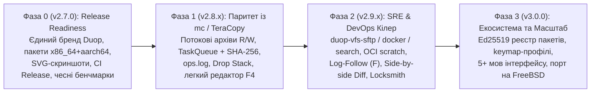

# Duop — Продуктова стратегія, SWOT-аналіз та план розвитку (`v2.7.0` → `v3.0.0`)

> **Дата:** 2026-11-20
> **Базова версія:** `v2.7.0` (`171` модуль `.c`, `28` модулів `.s` PAL, `186` тестових наборів, статичний ELF `187 КіБ` на `x86_64` / `209 КіБ` на `aarch64`)
> **Оновлення (`v2.11.0`):** архівний напрям фази 1 виконано (`201` модуль `.c`, `204` тестові набори, `249 КіБ` на `x86_64` / `285 КіБ` на `aarch64`): перегляд, розпакування, перевірка й створення архівів — див. [ARCHIVE_ROADMAP_2026-11-24.md](ARCHIVE_ROADMAP_2026-11-24.md); решта пунктів нижче — за планом.
> **Бренд і канонічний репозиторій:** **Duop** (`duop`), `https://github.com/BlackKostia/duop`

---

## 1. Позиціонування (Elevator Pitch)

**«Двопанельний файловий менеджер у терміналі розміром ~190 КіБ, якому не потрібно нічого: ні `libc`, ні `ncurses`, ні Python. Відкриває 4,8 млн файлів за 26 мс, працює на `x86_64` і `ARM64`, і має сучасні інструменти (fuzzy-пошук, прев'ю зображень, git-статуси, hex/ELF-інспектор, вбудований термінал) прямо з коробки.»**

### Цільові сегменти користувачів

| Сегмент | Головний біль | Чому обирають Duop |
| --- | --- | --- |
| **SRE / DevOps / Системні адміністратори** | На продакшн-сервері, в контейнері чи rescue-оточенні немає `mc`, а встановлювати залежності заборонено | Один статичний ELF-бінарник: `scp` або `docker cp` — і працює миттєво на `x86_64` та `aarch64` |
| **Розробники в терміналі** (аудиторія `yazi`/`lf`/`nnn`) | Повільні менеджери на великих монорепо, `node_modules`, AI/ML датасетах | Перший кадр за `26 мс` на 4,8 млн файлів, git-бейджі, fuzzy finder, підсвітка синтаксису, hex/ELF |
| **Embedded / ARM / Edge-пристрої** | Обмежена RAM та флеш-пам'ять, нестандартна або відсутня `libc` | `~15 МіБ` RSS на мільйонах файлів, `~209 КіБ` бінарник на `aarch64`, нуль зовнішніх бібліотек |
| **Користувачі класичних двопанельників (`NC`/`FAR`/`mc`)** | `mc` виглядає застарілим і зависає на великих каталогах; `FAR` не є нативним мінімалістичним Linux-інструментом | Класичні `F1`–`F10` + TrueColor теми, SGR-1006 миша, вкладки та Command Palette |

---

## 2. Сильні сторони (Strengths)

### 2.1 Унікальні технологічні переваги (УТП)
1. **Нуль залежностей, статичний ELF `~187–209 КіБ` (`.data = 0`, NX-safe):**
   - У `yazi` бінарник займає ~10–20 МіБ, у `ranger` потрібен Python, у `mc` — `glib` + `ncurses`.
   - Аргумент «скопіював один файл у будь-який Linux-контейнер і працюєш» є вирішальним для SRE/B2B.
2. **Екстремальна швидкодія та масштабованість:**
   - На каталозі з `4 798 976` файлів ([BENCHMARK_20M_2026-11-17.md](BENCHMARK_20M_2026-11-17.md)) перший кадр з'являється за **`26.4 мс`** при **`15.4 МіБ` Peak RSS**, тоді як `mc`, `yazi`, `lf`, `nnn`, `ranger` і `vifm` перевищили 60-секундний таймаут.
   - На `100 000` файлів перший кадр готовий за **`~113 мс`**.
   - У стані спокою — **0 пробуджень CPU** (`ppoll` з нескінченним таймаутом + `inotify`).
3. **Верифікована інженерна надійність:**
   - `186` автоматизованих тестових наборів (реальні PTY-сесії, диференційні тести C23 проти асемблерних оракулів, `qemu-aarch64`).
   - Кампанії fault-injection (`tools/faultlab/`), SEU bit-flip тести, fuzzing парсерів, статичний аудит ELF (`audit_elf_hardening.py`).
4. **Мультиархітектурна гібридна архітектура:**
   - 100% портативний freestanding C23 (`171` файл `.c`) поверх тонкого асемблерного PAL (`28` файлів `.s` для `linux/x86_64` та `linux/aarch64`).

### 2.2 Функціональна повнота «з коробки»
- **Навігація та пошук:** Command Palette (`Ctrl+K`), рекурсивний Fuzzy Finder (`Alt+P`), рекурсивний пошук/Grep у віртуальну панель (`Ctrl+F`), закладки (`Ctrl+D`), Frecency (`z`), вкладки (`Ctrl+T`/`Ctrl+W`), історія (`Alt+Left`/`Alt+Right`).
- **Перегляд та аналіз:** TrueColor підсвітка синтаксису (C, ASM, Python, Shell, JSON, Makefile, Markdown), інспектор ELF64, in-place Hex-редактор із Undo (`Ctrl+Z`), прев'ю зображень без зовнішніх бібліотек (Kitty graphics, Sixel, Unicode-блоки для PNG, JPEG, GIF, BMP, TGA, PNM, QOI).
- **Файлові операції:** фонові задачі через `fork` + `MAP_SHARED` із паузою та вирішенням конфліктів, `copy_file_range`/`FICLONE`, аналізатор Disk Usage (`Alt+D`), Bulk Rename (`Alt+B`), порівняння каталогів (`Alt+=`), XDG Trash із `Ctrl+Z` Undo.
- **Інтеграція та розширюваність:** вбудований PTY-термінал (`Ctrl+\``), Archive VFS і пакування (`.tar`, `.zip`, `.gz`/`.xz`/`.bz2`/`.zst` та `.tar.*`), Git-бейджі, OSC 52 буфер обміну, пакетний менеджер (`Alt+K`) та User Menu (`Alt+U`), локалізація (`*.lang`) і розкладки клавіатури (`*.layout`) як дані без перекомпіляції.

---

## 3. Слабкі сторони та ризики (Weaknesses & Threats)

### 3.1 Маркетингові та дистрибуційні бар'єри (закриваються у Фазі 0 — `v2.7.0`)
- **Відсутність свіжого бінарного релізу та розсинхронізація пакетів:** виправлено у `v2.7.0` (єдиний URL `github.com/BlackKostia/duop`, CI release job для `x86_64` + `aarch64`, оновлені `PKGBUILD`, `Formula/duop.rb`, `packaging/deb/`, `flake.nix`, `scripts/install.sh`).
- **Візуальна презентація:** додано відтворювані SVG-скриншоти (`tools/screenshot_svg.py` → `docs/media/*.svg`) та порівняльну таблицю в `README.md`.

### 3.2 Функціональні прогалини відносно конкурентів (`mc`, `yazi`, `FAR2L`)
| Функція | `mc` | `yazi` | `FAR2L` | **Duop (`v2.11.0`)** | План закриття |
| --- | :---: | :---: | :---: | :---: | --- |
| Створення архівів і повне розпакування | ✅ | частково | ✅ | ✅ (`v2.9.0` – `v2.11.0`: розпакування `Alt+F9`, пакування `Alt+F5`; редагування «на місці» — далі) | виконано; решта — [ARCHIVE_ROADMAP_2026-11-24.md](ARCHIVE_ROADMAP_2026-11-24.md) |
| Черга фонових операцій + SHA-256 верифікація | частково | ✅ | ✅ | ❌ (`-EBUSY` при другій задачі) | **Фаза 1 (`v2.8.x`)** |
| Вбудований текстовий редактор (`F4`) | ✅ (`mcedit`) | ❌ (`$EDITOR`) | ✅ | ❌ (`$EDITOR`, fallback `vi`) | **Фаза 1 (`v2.8.x`)** |
| Мережеві ФС (`sftp://`, `docker://`) | ✅ | плагіни | ✅ | ❌ (є VFS-контракт `virtual_mode=3`) | **Фаза 2 (`v2.9.x`)** |
| Підтримка FreeBSD / macOS | ✅ | ✅ | ✅ | ❌ (лише Linux `x86_64`/`aarch64`) | **Фаза 3 (`v3.0.0`)** |

---

## 4. Дорожня карта розвитку (`v2.7.0` → `v3.0.0`)

### Фаза 0 (`v2.7.0`) — Готовність до релізу та Go-to-Market ✅
1. Канонічний бренд **Duop** та репозиторій `https://github.com/BlackKostia/duop`.
2. Оновлені рецепти пакування з підтримкою `x86_64` і `aarch64` та коректними залежностями збірки (`gcc`/`clang`, `python3`, `binutils`, `make`):
   - [packaging/aur/PKGBUILD](../packaging/aur/PKGBUILD)
   - [Formula/duop.rb](../Formula/duop.rb)
   - [packaging/deb/build-deb.sh](../packaging/deb/build-deb.sh) та [packaging/deb/control](../packaging/deb/control)
   - [flake.nix](../flake.nix)
   - [scripts/install.sh](../scripts/install.sh) (завантаження готового бінарника з перевіркою `SHA256SUMS` + fallback на збірку з коду)
   - [scripts/make_dist.sh](../scripts/make_dist.sh) та release-job у [.github/workflows/ci.yml](../.github/workflows/ci.yml)
3. Візуальні матеріали в `docs/media/*.svg` (генеруються детерміновано через [tools/screenshot_svg.py](../tools/screenshot_svg.py)).
4. Документація для спільноти: [CONTRIBUTING.md](../CONTRIBUTING.md), шаблони Issues/PR у `.github/`, матеріали анонсів у `docs/launch/`.

### Фаза 1 (`v2.8.x`) — Закриття бар'єрів переходу з `mc`/`FAR` (деталі в [DEVELOPMENT_PLAN_2026-11-17.md](DEVELOPMENT_PLAN_2026-11-17.md))
- Потокове розпакування та створення архівів (`.tar`, `.tar.gz`, `.zip`/ZIP64) на freestanding C23 без ліміту 4 МіБ / 1024 записів, із захистом від Zip-Slip та перевіркою CRC32.
- Послідовна черга задач `TaskQueue`, опційна SHA-256 верифікація після копіювання/переміщення, ротований журнал `$XDG_STATE_HOME/duop/ops.log`, фоновий `Trash`.
- Крос-директорний буфер збору файлів **Drop Stack** (`virtual_mode = 4`).
- Опційний вбудований легкий текстовий редактор на `F4` (поверх існуючого `ViewerDialog` та `syntax.c`) із збереженням підтримки зовнішнього `$EDITOR`.

### Фаза 2 (`v2.9.x`) — Домінування в ніші SRE / Containers
- Офіційні out-of-process VFS-провайдери: `duop-vfs-sftp`, `duop-vfs-docker`, `duop-vfs-search` (нульовий вплив на розмір статичного бінарника `duop`).
- Мінімальний OCI-образ `FROM scratch` (`packaging/oci/Dockerfile`) для `kubectl debug` та `docker cp`.
- Режим `Follow` (`F`, live log-tailing через `inotify`) та Side-by-side Text Diff у `ViewerDialog`.
- Інструмент `/proc/*/fd` Locksmith («Який процес тримає цей файл?»).

### Фаза 3 (`v3.0.0`) — Екосистема, кастомізація та кросплатформність
- Криптографічна перевірка реєстру пакетів `registry.tsv.sig` (freestanding `Ed25519` у `.rodata`).
- Налаштовувані профілі гарячих клавіш у `duoprc` (пресети `default`, `mc`, `vim`/`yazi`).
- Розширення мовних пакетів `lang/*.lang` силами спільноти (DE, PL, ES, FR).
- Новий PAL-бекенд `src/os/freebsd/x86_64/` для нативної роботи на FreeBSD.
- Новий PAL-бекенд `src/os/windows/x86_64/` для збірки **`duop.exe` під Windows** через тонкий POSIX-шар MSYS2/Cygwin (детальна специфікація у [WINDOWS_PORT_PLAN.md](WINDOWS_PORT_PLAN.md)).

---

## 5. Ключові метрики успіху (KPIs)

| Метрика | Ціль (1 місяць) | Ціль (3 місяці) | Ціль (6 місяців) |
| --- | ---: | ---: | ---: |
| GitHub Stars ⭐ | 500 | 2 000 | 5 000 |
| Зовнішні контриб'ютори | 3 | 10 | 25 |
| Офіційні пакетні репозиторії | GitHub Releases, AUR, Homebrew tap | + Nixpkgs, Debian/Ubuntu `.deb` | + Alpine (`apk`), Fedora COPR |
| Мови інтерфейсу (`lang/*.lang`) | 2 (EN, UA) | 4 (+ DE, PL) | 6+ |
| Офіційні пакети розширень (`packages/`) | 2 (`inspect`, `sysmon`) | 5 (+ `sftp`, `docker`, `search`) | 10+ |
