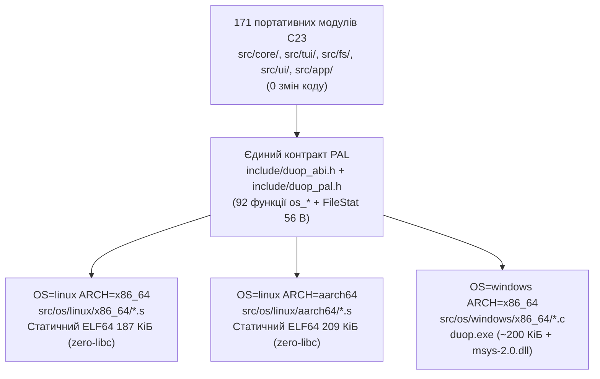

# План портування Duop під Windows (`duop.exe` — Варіант 3: MSYS2 / Cygwin POSIX PAL)

> **Дата документа:** 2026-11-23
> **Статус:** Затверджена специфікація для подальшої реалізації (`make OS=windows ARCH=x86_64`)
> **Вплив на Linux-версію:** **Нульовий** (100% ізоляція в окремому compile-time PAL-каталозі `src/os/windows/x86_64/`; жоден байт Linux-бінарника `duop` для `x86_64`/`aarch64` не змінюється).

---

## 1. Мета та архітектурна ідея

Отримати повнофункціональний Windows-бінарник **`duop.exe`** для Windows 10/11 (`x86_64`, Windows Terminal / ConPTY) із **мінімальним обсягом нового коду (~500–600 рядків у `src/os/windows/x86_64/`)** і **нульовими змінами у 171 прикладному модулі C23** (`src/core/`, `src/tui/`, `src/fs/`, `src/ui/`, `src/app/`).

### Чому обрано Варіант 3 (MSYS2 / Cygwin POSIX PAL) як перший крок на Windows
1. **Повна сумісність із наявною архітектурою процесів і шляхів Duop:**
   - Фоновий воркер копіювання/переміщення (`TaskWorker`), асинхронне прев'ю (`preview_io.c`), пакетний менеджер (`pkg_fetch.c`), інтеграція з `git status` та вбудований PTY-термінал (`term_pane.c`) використовують POSIX-семантику: `os_fork()`, `os_mmap(..., MAP_SHARED)`, `os_pipe2()`, `os_wait4()`, `os_pty_spawn()` і шляхи з роздільником `/` (`/c/Users/...`).
   - Тонкий шар `msys-2.0.dll` / `cygwin1.dll` уже надає реалізацію `fork()`, віртуальної `/proc`, POSIX-сигналів і ConPTY-мосту до Windows Terminal.
2. **Повторне використання цього ж PAL для FreeBSD та macOS:**
   - Оскільки `src/os/windows/x86_64/` реалізує 92 функції `os_*` з [`include/duop_abi.h`](../include/duop_abi.h) поверх стандартних POSIX-викликів, цей самий бекенд (3 файли `.c` по ≤ 250 рядків) одночасно слугує референсним POSIX-PAL для майбутньої збірки на FreeBSD та macOS.
3. **Повна ізоляція від zero-`libc` Linux-бінарника:**
   - Linux-таргети (`OS=linux ARCH=x86_64` та `OS=linux ARCH=aarch64`) залишаються **100% статичними zero-`libc` ELF64** (перевіряються `audit_elf_hardening.py`).
   - Windows-таргет активується лише явною командою `make OS=windows ARCH=x86_64` і збирає `duop.exe` (+ `msys-2.0.dll` для автономного ZIP-архіву під Windows).



---

## 2. Точний обсяг змін за файлами

Загальний обсяг: **3 нові файли в `src/os/windows/x86_64/` (~520 рядків C)** + **~40 рядків умовних блоків у `include/duop_pal.h` та `Makefile`**. Дотримуються бюджети `duop-lean-modules` (кожен файл ≤ 500 рядків, кожна функція ≤ 80 рядків, ≤ 16 експортованих функцій або поділ на 3 модулі).

### 2.1 `include/duop_pal.h` (~25 рядків під `#if defined(__CYGWIN__) || defined(DUOP_OS_WINDOWS)`)
У Cygwin/MSYS2 числові значення кількох прапорців `open()` та кодів `errno` відрізняються від Linux UAPI:

| Константа | Значення Linux (`x86_64`) | Значення MSYS2 / Cygwin | Примітка |
| --- | ---: | ---: | --- |
| `EAGAIN` | `11` | `11` | Збігається |
| `ENOTEMPTY` | `39` | `90` | Важливо для `os_unlinkat(..., AT_REMOVEDIR)` |
| `ENOSYS` | `38` | `88` | Важливо для fallback `io_uring`/`inotify`/`copy_file_range` |
| `EOPNOTSUPP` | `95` | `95` | Збігається |
| `ECANCELED` | `125` | `140` | Скасування фонової операції |
| `O_CREAT` | `0x40` | `0x0200` | Створення файлів |
| `O_EXCL` | `0x80` | `0x0800` | Захист від перезапису (`duop-destructive-ops-guard`) |
| `O_TRUNC` | `0x200` | `0x0400` | Перезапис |
| `O_APPEND` | `0x400` | `0x0008` | Журнали та дописування |
| `O_NONBLOCK` | `0x800` | `0x4000` | Неблокуючі пайпи/PTY |
| `O_DIRECTORY` | `0x10000` | `0x200000` | Відкриття дескриптора каталогу |
| `O_NOFOLLOW` | `0x20000` | `0x100000` | Захист від symlink- перегонів (`duop-path-safety`) |
| `O_CLOEXEC` | `0x80000` | `0x40000` | Автозакриття FD при `execve` |
| `AT_FDCWD` | `-100` | `-2` | Базовий дескриптор поточної теки для `*at()` |

> **Альтернативний варіант (ще чистіший):** залишити константи в `include/duop_pal.h` незмінними, а трансляцію бітових прапорців `O_*` / `AT_*` та кодів `-errno` виконувати всередині маленької таблиці в `src/os/windows/x86_64/pal_sys.c` (`win_flags_from_pal()` та `win_errno_to_pal()`). Тоді `include/duop_pal.h` не змінюється взагалі!

---

### 2.2 Нові файли PAL у `src/os/windows/x86_64/` (~520 рядків, 3 модулі `.c`)

Щоб кожен модуль мав ≤ 16 не-`static` функцій і ≤ 250 рядків (згідно з `duop-lean-modules`), 92 функції `os_*` діляться на 4 компактні файли:

#### 1. `[NEW] src/os/windows/x86_64/pal_sys_fd.c` (~130 рядків, ≤ 16 експортів)
Базові файлові та дескрипторні операції (обгортки з поверненням `-pal_errno(errno)` при `< 0` та трансляцією прапорців `O_*` і `AT_FDCWD`):
- `os_read`, `os_write`, `os_close`, `os_fsync`, `os_ftruncate`, `os_lseek`, `os_ioctl`, `os_fcntl`, `os_pipe2`, `os_openat`, `os_dup2`, `os_mkdirat`, `os_unlinkat`, `os_renameat2` (через `renameat` + перевірка `EEXIST` для `RENAME_NOREPLACE`), `os_symlinkat`, `os_readlinkat`.

#### 2. `[NEW] src/os/windows/x86_64/pal_sys_proc.c` (~140 рядків, ≤ 16 експортів)
Атрибути шляхів, процеси та пам'ять:
- `os_linkat`, `os_fchmodat`, `os_fchownat`, `os_getcwd`, `os_chdir`;
- `os_fork`, `os_execve`, `os_wait4`, `os_kill`, `os_exit`, `os_getpid`, `os_getppid`, `os_gettid`, `os_setsid`, `os_getuid`;
- `os_mmap`, `os_munmap_raw`, `os_mem_remap` (`mmap` + `memcpy` + `munmap`, оскільки в MSYS2 немає Linux `mremap`), `os_mmap_file_ro`, `os_munmap`.

#### 3. `[NEW] src/os/windows/x86_64/pal_os_fs.c` (~150 рядків, ≤ 16 експортів)
Нормалізована файлова система, `FileStat` (56 байтів), читання каталогів та безпечні заглушки Linux-специфічних прискорювачів:
- `os_statat`, `os_fstat`, `os_du_usage`, `os_fstat_du`: заповнення 56-байтової структури `FileStat` зі `struct stat` (`st_dev`, `st_ino`, `st_size`, `st_mtim.tv_sec`, `st_mode`, `st_mtim.tv_nsec`, `st_nlink`, `st_uid`, `st_gid`) та `st_blocks * 512`;
- `os_dir_read` / `os_dir_next` / `os_dir_next_ex`: читання каталогу через `fdopendir(dup(dirfd))` + `readdir()` з пакуванням записів у буфер формату `(uint8_t d_type, char name[])`, який потім розбирає `os_dir_next_ex`;
- `os_batch_stat`: цикл викликів `os_statat` (замість Linux `io_uring`);
- `os_clone_file` → `-ENOSYS`, `os_copy_file_range` → `-ENOSYS` (`file_ops_copy.c` автоматично використовує свій буферизований `read`/`write` цикл);
- `os_watch_init` / `os_watch_add` / `os_watch_rm` / `os_watch_read` / `os_watch_next` → `-ENOSYS` (або опційна обгортка над `ReadDirectoryChangesW` у другій ітерації);
- `os_fs_is_derived` → перевірка `/proc` та `/cygdrive` за `fstatfs`.

#### 4. `[NEW] src/os/windows/x86_64/pal_term_pty.c` (~140 рядків, ≤ 16 експортів)
Термінал, опитування подій (`poll`), PTY, час, потоки та SIMD:
- `os_poll_in`, `os_poll_in2`, `os_poll_many`, `os_poll_out`, `os_set_nonblock`, `os_pipe_cloexec`: через стандартний POSIX `poll()`;
- `os_get_winsize`, `os_get_winsize_px`, `os_term_save_and_raw`, `os_term_restore`: через `tcgetattr`/`tcsetattr` (`cfmakeraw`) та `ioctl(STDOUT_FILENO, TIOCGWINSZ, &ws)`;
- `os_pty_spawn`, `os_pty_resize`, `os_pty_read`, `os_pty_write`, `os_pty_close`: через `openpty()` + `fork()` + `execve("/bin/sh" / "$SHELL")` (MSYS2 автоматично підключає ConPTY для Windows-консолі);
- `os_clock_ms` (`CLOCK_MONOTONIC`), `os_time_sec` (`CLOCK_REALTIME`);
- `os_signals_install`, `os_signals_worker_mode`, `os_sig_reset_pipe`, `os_sigbus_guard_install`, `os_fault_guard_install_slot`, `os_try_begin` (`sigsetjmp`/`siglongjmp` для захисту від `SIGBUS`/`SIGSEGV` на `mmap`);
- `os_thread_spawn` / `os_thread_join` (`pthread_create` або синхронний fallback, де `*ctid_out = 0`);
- `os_mem_copy_fast`, `os_mem_move_fast`, `os_mem_set_fast`, `os_mem_cmp_fast`, `os_str_len_fast`, `os_str_contains_ci_fast`, `os_mem_mismatch16`, `os_mem_find_byte`, `os_mem_count_byte` + точка входу `main(int argc, char **argv, char **envp) { return duop_main(argc, argv, envp, NULL); }`.

---

### 2.3 `Makefile` (~15 рядків)
Додається умовний блок `ifeq ($(OS),windows)`:
```makefile
ifeq ($(OS),windows)
TARGET    := duop.exe
BUILD     := build_windows_$(ARCH)
PAL_SRCS  :=
PAL_START_SRCS :=
WIN_PAL_C := $(wildcard src/os/windows/$(ARCH)/*.c)
# На MSYS2 PAL компілюється з системними заголовками POSIX, а 171 модуль ядра — з тим самим -ffreestanding
LDFLAGS   := -Wl,--gc-sections
endif
```
Усі правила для `OS=linux` (`x86_64` та `aarch64`), хуки `pre-commit` / `pre-push` та `verify_build.sh` залишаються **повністю незмінними**.

---

## 3. Пакування та дистрибуція для Windows

Після збірки в MSYS2 створюється автономний портативний ZIP-архів **`duop-windows-x86_64.zip`**, який не потребує встановлення MSYS2 на комп'ютері користувача:

```text
duop-2.x.x-windows-x86_64/
├── duop.exe              # Бінарник Duop (~200 КіБ)
├── msys-2.0.dll          # POSIX-рантайм (~3 МіБ, береться з /usr/bin/msys-2.0.dll під час пакування)
├── lang/
│   └── uk.lang           # Український мовний пакет
├── layouts/
│   └── uk.layout         # Українська розкладка для гарячих клавіш
├── LICENSE
└── README.md
```

Користувач на Windows 10/11 просто розпаковує ZIP у будь-яку теку і запускає `duop.exe` у **Windows Terminal** (або встановлює через `scoop` / `winget`).

### Автоматизація в GitHub Actions CI (`.github/workflows/ci.yml`)
Додається окремий незалежний job `build-windows-msys2`:
```yaml
  build-windows-msys2:
    runs-on: windows-latest
    defaults:
      run:
        shell: msys2 {0}
    steps:
      - uses: actions/checkout@v4
      - uses: msys2/setup-msys2@v2
        with:
          msystem: MSYS
          install: git make gcc binutils python
      - name: Build duop.exe and run smoke tests
        run: |
          make OS=windows ARCH=x86_64 release
          ./duop.exe --version
          ./duop.exe -L | cmp - LICENSE
```

---

## 4. План верифікації (`duop-tdd-first`)

1. **Незмінність Linux-бінарників (Регресійний гейт):**
   - `./.agents/skills/duop-pty-verify/scripts/verify_build.sh` має проходити на 100%, а `duop` на `linux/x86_64` та `linux/aarch64` зберігати `.data = 0`, zero-`libc` і побітову відповідність.
2. **Тест POSIX PAL на Linux перед запуском на Windows (`tests/test_posix_pal.py`):**
   - Оскільки `src/os/windows/x86_64/*.c` використовує стандартний POSIX API, його можна скомпілювати і протестувати навіть на Linux (`make OS=posix`) за допомогою існуючого `tools/pal_selftest/pal_selftest.c` (`63/63` перевірки PAL) та `tests/test_pty.py` ще до відправки на Windows-раннер!
3. **Нативна перевірка на Windows (`windows-latest` у GitHub Actions + Windows Terminal):**
   - `duop.exe --version`, `duop.exe --help`, `duop.exe --license`;
   - навігація по дисках `/c/`, `/d/`, копіювання (`F5`), переміщення (`F6`), видалення (`F8`), перегляд зображень і коду (`F3`/`F9`), Command Palette (`Ctrl+K`), перемикання мови EN/UA (`Alt+L`) та тем (`Alt+T`).
